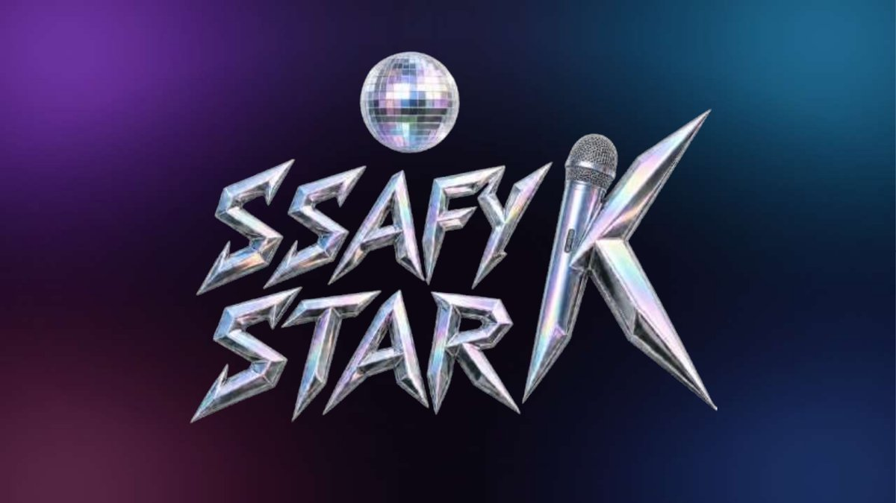
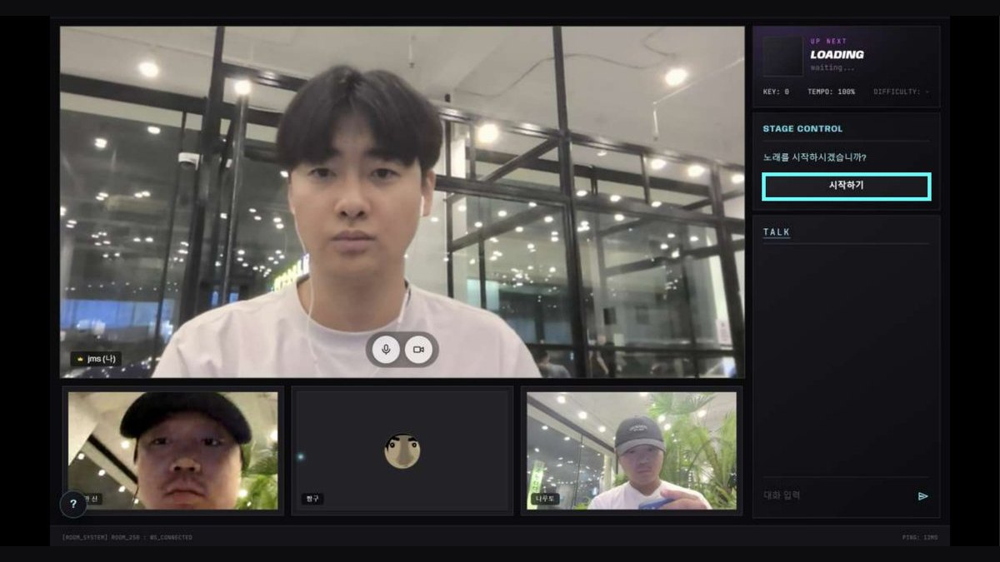
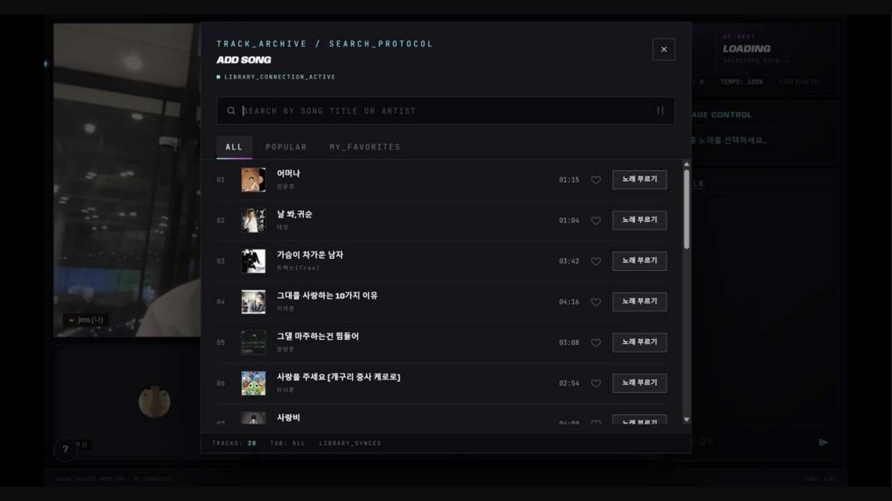
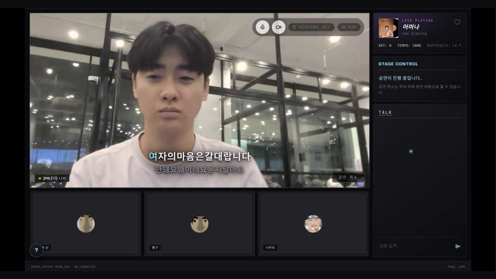
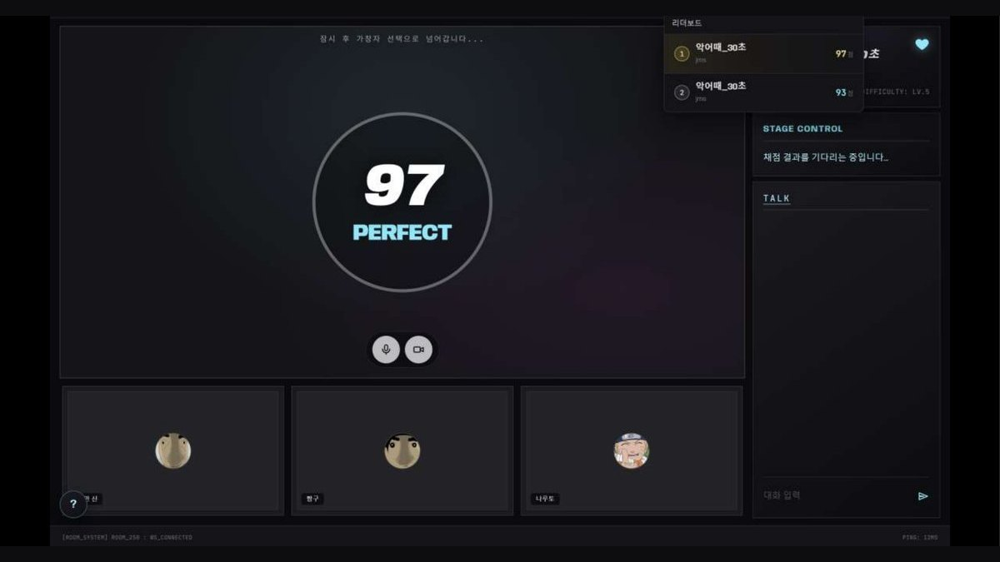
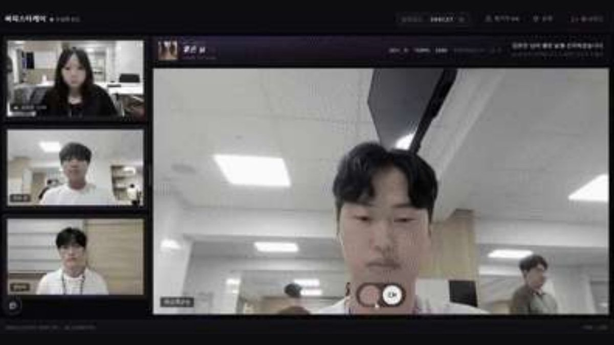
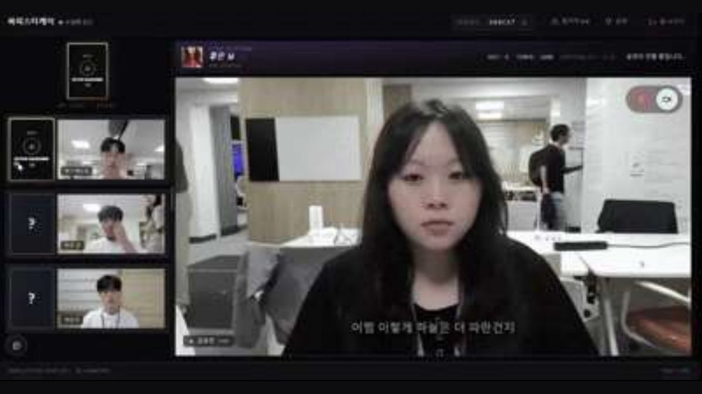
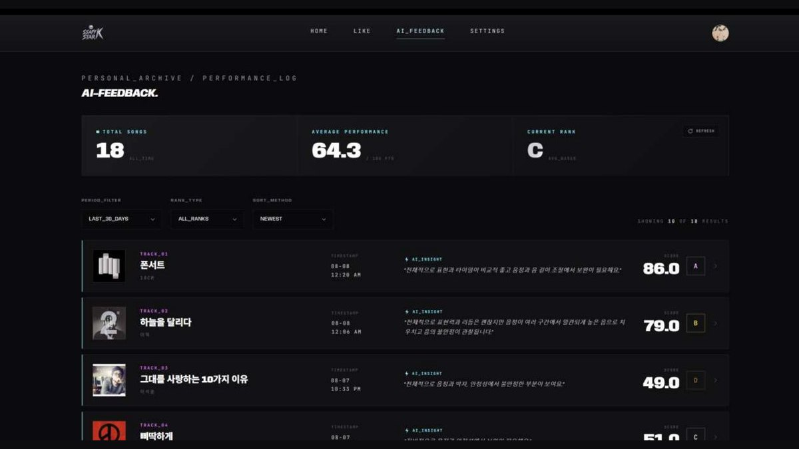
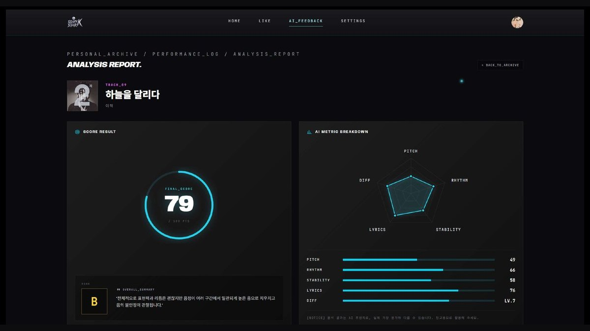
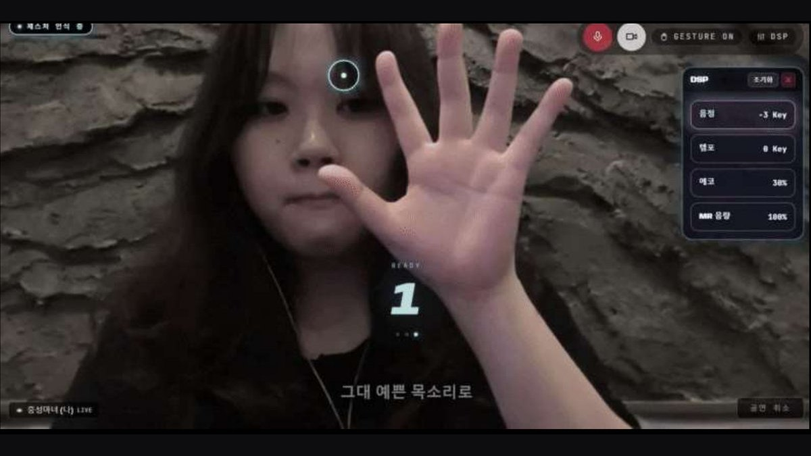

  

# 싸스케 · SSAFY STAR K 🎤

> **노래는 한 명, 훼방은 전원.** — 최대 4명이 함께 부르고, 카드로 겨루고, AI 피드백으로 돌아보는 실시간 화상 노래방

SSAFY 15기 D206 팀 프로젝트입니다. 일반 노래방에서는 서로의 무대를 감상하고, 배틀에서는 키·템포 변경이나 가사 가리기 카드로 가창자를 방해할 수 있습니다. 노래가 끝나면 가창 점수와 개인별 AI 피드백을 확인합니다. 웹 프론트엔드·백엔드·AI 서비스·네이티브 오디오 엔진을 하나의 저장소에서 관리합니다.

## 📸 화면

| 노래방 입장 | 곡 검색 | 가사 싱크와 함께 가창 |
| :---: | :---: | :---: |
|  |  |  |
| **가창 점수** | **카드 배틀 · 카드 배정** | **카드 배틀 · 카드 사용** |
|  |  |  |
| **AI 피드백 기록** | **곡별 분석 리포트** | **제스처 컨트롤** |
|  |  |  |

## ✨ 주요 기능

- **세 가지 노래방 모드** — 웹에서 즐기는 일반 노래방과 카드 배틀, Windows 앱으로 함께 부르는 저지연 합창 모드를 제공합니다.
- **카드 배틀** — 노래하지 않는 참가자도 키 변경·템포 변경·마이크 난입·가사 가리기 카드로 무대에 개입하고 점수를 겨룹니다.
- **AI 채점과 맞춤 피드백** — 음정·박자·안정성·가사 정확도·난이도로 점수를 매기고, 규칙 기반 판정 + RAG 근거 + LLM 표현으로 강점·약점·연습 방법을 알려줍니다.
- **실시간 오디오 처리** — SoundTouch(WSOLA)로 피치를 유지한 채 키·템포를 바꾸고, RNNoise로 잡음을 줄이며, 에코·리버브·음량을 조절합니다.
- **제스처 컨트롤** — 마우스 없이 손동작으로 마이크·카메라·DSP 창을 켜고 끄고, 취소 같은 중요한 조작은 확인까지 받습니다.
- **곡 자동 등록** — 원곡과 가사를 올리면 보컬을 분리해 반주·기준 음표·난이도·가사 타이밍을 생성합니다.

## 🛠 기술 스택

| 영역 | 기술 |
| --- | --- |
| Frontend | Next.js 16, React 19, TypeScript, Tailwind CSS 4, TanStack Query, Zustand, STOMP |
| 웹 오디오·영상 | OpenVidu 2.32, WebRTC, Web Audio·AudioWorklet, SoundTouch, Pitchy, RNNoise |
| Backend | Java 17, Spring Boot, Spring Security(OAuth2·JWT), JPA |
| 데이터·저장소 | MySQL, Redis(공연 상태·Lua CAS), Amazon S3 |
| AI 곡 분석 | Python, FastAPI, PyTorch, audio-separator, librosa, Whisper |
| AI 채점·피드백 | FastAPI, STT·LLM API, PostgreSQL·pgvector(RAG) |
| Native Audio | Rust, WASAPI, Opus, ICE·UDP P2P |
| 인프라·검증 | AWS(ALB, Private Subnet, NAT Gateway), Docker, Gradle, pnpm, Cargo, JUnit, Testcontainers |

시스템 구조, 기술적 해결 과제, 실행 방법은 [상세 문서](docs/README.md)에 정리했습니다.
