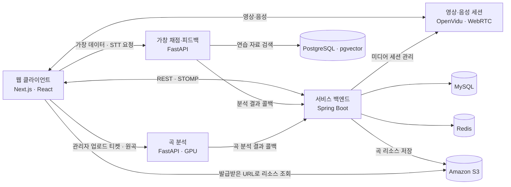

싸스케 · SSAFY STAR K

> **노래는 한 명, 훼방은 전원.**
> 친구와 함께 부르고, 카드로 겨루고, AI 피드백으로 돌아보는 실시간 화상 노래방

싸스케는 최대 **4명**이 한 방에서 노래와 게임을 함께 즐기는 서비스입니다. 일반 노래방에서는 서로의 무대를 감상하고, 배틀에서는 키·템포 변경이나 가사 가리기 카드로 가창자를 방해할 수 있습니다. 노래가 끝나면 가창 점수와 개인별 피드백을 확인합니다. 동시에 노래하는 경험을 위해 Windows 네이티브 앱 기반의 저지연 합창 모드도 구현했습니다.

**SSAFY 15기 D206 팀 프로젝트**이며, 웹 프론트엔드·백엔드·AI 서비스·네이티브 오디오 엔진을 하나의 저장소에서 관리합니다.

[주요 기능](#주요-기능) · [시스템 구조](#시스템-구조) · [기술적 해결 과제](#기술적-해결-과제) · [기술 스택](#기술-스택) · [실행 안내](#실행-안내)

## 프로젝트 소개

온라인에서 함께 노래하려면 영상 통화 외에도 반주와 가사의 타이밍, 참가자의 상태, 노래가 끝난 뒤의 경험을 연결해야 합니다. 싸스케는 **함께 즐기는 재미**, **실시간 진행의 일관성**, **가창 후 구체적인 피드백**을 중심으로 설계했습니다.

- **관객도 참여하는 무대:** 배틀 카드를 통해 노래하지 않는 참가자도 공연에 개입합니다.
- **다음 곡까지 이어지는 경험:** 곡 검색·즐겨찾기부터 공연, 순위 확인, 개인 기록 조회까지 연결합니다.
- **동시에 부르기 위한 오디오 경로:** 저지연 합창은 Windows 오디오 장치 제어와 직접 P2P 음성 전송을 사용합니다.

## 주요 기능

### 세 가지 노래방 모드

| 모드 | 사용자 경험 | 실행 환경 |
| --- | --- | --- |
| **일반 노래방** | 가창자를 선택하고, 반주·가사에 맞춰 노래하며 다른 참가자와 영상·음성을 공유 | 웹 브라우저 |
| **카드 배틀** | 가창 중 키 변경, 템포 변경, 마이크 난입, 가사 가리기 카드 사용 및 점수 경쟁 | 웹 브라우저 |
| **저지연 합창** | 참가자 간 직접 음성 전송과 각 PC의 반주 동기 재생으로 함께 노래 | 웹에서 입장 후 Windows 앱 실행 |

### 함께 쓰는 기능

| 기능 | 설명 |
| --- | --- |
| 소셜 로그인 | Google·Kakao 로그인, 닉네임 및 프로필 관리 |
| 방 생성·초대 | 모드별 방 생성, 초대 코드 입장, 참가자 관리와 채팅 |
| 곡 탐색 | 곡 검색, 즐겨찾기, 가사 조회 |
| 노래방 오디오 | 마이크·출력 장치 설정, 음량·에코·리버브 조절, 반주 키·템포 변경 |
| 가사 동기화 | 현재·다음 소절 표시, 간주 후 카운트다운, 분석 데이터가 있는 곡의 음절별 하이라이트 |
| 가창 채점·AI 피드백 | 웹 공연의 음정·박자·안정성·가사 일치도를 분석하고 강점·개선점·연습 방법 제공 |
| 개인 기록 | 마이페이지에서 공연 통계, 최근 활동, AI 피드백 이력 확인 |
| 관리자 곡 등록 | 원곡과 가사를 업로드하면 보컬 분리, 반주·기준 음표·난이도·가사 타이밍 생성 |

웹 모드의 기본 흐름은 **로그인 → 방 생성 또는 초대 코드 입장 → 가창자·곡 선택 → 준비 및 공연 → 점수·순위 확인 → 개인 피드백 조회**입니다.

> 실제 AI 채점은 `NEXT_PUBLIC_DEMO_MOCK_SCORING=false`로 활성화합니다. 현재 프론트엔드 기본값은 시연용 데모 채점이며, 자세한 연결 방법은 아래 실행 안내에 정리했습니다. 저지연 합창의 지원 환경과 검증 범위도 함께 확인할 수 있습니다.

## 시스템 구조



- **백엔드:** 사용자·방·공연·카드·결과를 관리합니다. MySQL에는 영속 데이터를, Redis에는 진행 중인 공연과 카드 상태·순위·복구 기한 등을 저장합니다.
- **웹 미디어:** OpenVidu로 영상·음성을 공유하고, Web Audio 기반 엔진으로 반주와 마이크 효과를 처리합니다.
- **AI:** 곡 등록 시 실행하는 분석 서비스와 공연 후 사용하는 채점·피드백 서비스를 분리했습니다. 채점·피드백 서비스는 STT, 벡터 검색, LLM API와 연동합니다.
- **저지연 합창:** Spring의 방·곡·공연 API를 공유합니다. Rust rendezvous 서버가 참가자 연결 정보를 교환하고, 실제 음성은 Windows 앱 사이에서 직접 UDP P2P로 전달합니다. 반주는 각 앱이 내려받아 로컬에서 동기 재생합니다.

## 기술적 해결 과제

### 1. 동시 요청과 장애 상황에서도 공연 상태를 일관되게 유지

**문제:** 재생 시작·취소·퇴장 요청이 겹치거나 DB 처리가 실패하면, MySQL의 방 상태와 Redis의 공연 상태가 어긋날 수 있습니다.

**해결:** 방 단위 비관적 잠금과 Redis Lua 스크립트를 사용해 상태 전환을 제어합니다. 공연 스냅샷은 이전 값이 일치할 때만 교체하고, DB 트랜잭션이 롤백되면 Redis 변경을 보상합니다. 보상 시에도 현재 값을 비교해 다른 요청이 갱신한 상태를 덮어쓰지 않도록 했습니다. 공연 이벤트는 커밋 이후 발행하며, 연결 종료와 분석 지연은 복구 기한 및 워커로 처리합니다.

**코드:** [공연 상태 저장소](backend/ssasukae/src/main/java/com/ssafy/ssasukae/domain/performance/redis/performance/RedisPerformanceStore.java) · [트랜잭션 보상 처리](backend/ssasukae/src/main/java/com/ssafy/ssasukae/domain/performance/service/PerformanceTransactionSupport.java) · [공연 복구](backend/ssasukae/src/main/java/com/ssafy/ssasukae/domain/performance/service/PerformanceRecoveryService.java)

### 2. 카드 효과와 가사 표시를 실제 오디오 재생에 연결

**문제:** 배틀 중 반주 속도나 키가 바뀌어도 마이크 효과와 가사 표시가 공연 흐름을 따라가야 합니다.

**해결:** Web Audio·AudioWorklet 기반 오디오 엔진에서 마이크와 반주를 처리하고, SoundTouch로 키·템포를 조절합니다. 가사 표시에는 재생 위치와 배속을 반영하며, 음절 하이라이트는 말단 UI에서 재생 시계를 읽어 무대 전체의 불필요한 리렌더링을 줄입니다. 카드의 배정·예약·발동·종료는 서버 이벤트와 프론트엔드 상태로 연결합니다.

**코드:** [보컬 오디오 엔진](frontend/src/features/vocal-audio-engine/model/createVocalAudioEngine.ts) · [가사 동기화](frontend/src/widgets/performance-room/model/useSyncedLyrics.ts) · [카드 효과 적용](frontend/src/widgets/performance-room/model/useCardEffectSideEffects.ts)

### 3. 원곡 분석부터 개인별 연습 피드백까지 연결

**문제:** 점수만으로는 어떤 구간에서 무엇을 개선해야 하는지 알기 어렵습니다. 채점에 사용할 기준 음표와 가사 타이밍도 원곡에서 생성해야 합니다.

**해결:** 곡 등록 단계에서 보컬·반주를 분리하고, pYIN 기반 음높이 분석과 가사 정렬로 기준 데이터를 생성합니다. 웹 공연에서는 음높이를 50ms 간격으로 수집하고 음성을 30초 단위로 STT에 전달합니다. 채점 서버는 기준·가창 음표를 비교해 점수를 계산하고, 관찰된 오류와 pgvector로 검색한 연습 자료를 LLM에 전달해 개인별 피드백을 생성합니다.

**코드:** [곡 분석 파이프라인](ai/song-analysis/main.py) · [가창 데이터 수집](frontend/src/features/performance-scoring) · [채점 로직](ai/scoring-feedback/app/services/score_service.py) · [피드백 생성](ai/scoring-feedback/app/services/feedback_service.py) · [RAG 검색](ai/scoring-feedback/app/services/rag_service.py)

### 4. 동시에 노래하기 위한 저지연 음성 전송

**문제:** 합창에서는 상대 목소리의 지연과 지연 편차가 박자에 직접 영향을 줍니다. 오디오 장치의 버퍼와 네트워크 수신 큐까지 제어할 수 있어야 합니다.

**해결:** Rust·WASAPI로 Windows 오디오 입출력을 구성하고, Opus 2.5ms 프레임을 최대 4인의 Full Mesh P2P 경로로 전송합니다. 참가자별 지터 버퍼와 손실 보정, 장치 클록 차이 보정을 적용합니다. 반주는 전송 음성에 섞지 않고 각 PC에서 재생하며, 준비 상태·오디오 지문·재생 위치를 교환해 시작 시점과 진행 위치를 맞춥니다.

**검증 범위:** 2인 연결 시험과 로컬 4인 합성 시험 기록이 있으며, 실제 Windows PC 4대의 장시간 음성 검증은 남아 있습니다. **2.5ms는 코덱 프레임 길이**이며 전체 음성 전달 지연을 의미하지 않습니다. 유선 LAN·유선 이어폰과 직접 P2P 연결이 지원 조건이고, TURN 중계가 없어 UDP 차단·일부 NAT 환경에서는 연결이 제한됩니다.

**코드·문서:** [오디오 클라이언트](native/low-latency-audio/apps/audio-client/src/lib.rs) · [MR 동기화](native/low-latency-audio/apps/audio-client/src/mr_sync.rs) · [진행 및 검증 현황](native/low-latency-audio/docs/phase-status.md) · [패킷 보안·장치·설치 안내](native/low-latency-audio/docs/security-and-device-update.md)

## 기술 스택

| 영역 | 기술 | 사용 목적 |
| --- | --- | --- |
| Frontend | Next.js 16, React 19, TypeScript, Tailwind CSS 4 | 웹 UI 및 라우팅 |
| 상태·통신 | TanStack Query, Zustand, STOMP | 서버 데이터 조회, 화면 상태, 실시간 이벤트 |
| 웹 오디오·영상 | OpenVidu 2.32, WebRTC, Web Audio, AudioWorklet, SoundTouch, Pitchy | 화상 노래방, 음향 효과, 키·템포 조절, 음높이 수집 |
| Backend | Java 17, Spring Boot 4.1, Spring Security, JPA | 도메인 로직, OAuth2·JWT 인증, 데이터 접근 |
| 데이터·저장소 | MySQL, Redis, Amazon S3 | 영속 데이터, 실시간 상태, 곡 리소스 |
| AI 곡 분석 | Python, FastAPI, PyTorch, audio-separator, librosa, Whisper | 보컬 분리, 기준 음표 추출, 가사 타이밍 정렬 |
| AI 피드백 | FastAPI, STT·LLM API, PostgreSQL·pgvector | 채점, 가사 인식, 근거 자료 검색 및 피드백 |
| Native Audio | Rust, WASAPI, Opus, ICE·UDP P2P | Windows 저지연 합창 |
| 빌드·검증 | Gradle, pnpm, Cargo, Docker, JUnit, Testcontainers | 서비스별 빌드, 패키징, 테스트 |

프론트엔드는 `app → widgets → features → entities → shared`의 FSD 레이어로 구성합니다. 백엔드는 방·공연·카드·곡 등의 도메인을 나누고, AI 서비스는 **곡 분석**과 **채점·피드백**을 별도 프로세스로 실행합니다.

## 저장소 구조

```text
.
├── frontend/                 # Next.js 웹 클라이언트
│   └── src/
│       ├── app/              # 라우팅·전역 설정
│       ├── widgets/          # 화면을 구성하는 UI 묶음
│       ├── features/         # 사용자 행동 및 오디오·채점 기능
│       ├── entities/         # 도메인 타입·상태·API
│       └── shared/           # 공통 UI·유틸리티
├── backend/ssasukae/          # Spring Boot API·실시간 상태 관리
├── ai/
│   ├── song-analysis/        # 원곡 분석·반주·기준 데이터 생성
│   └── scoring-feedback/     # STT·가창 채점·RAG 피드백
├── native/low-latency-audio/  # Rust Windows 앱·P2P 연결 서버
└── docs/                     # 협업 컨벤션·서비스 연동 명세
```

## 실행 안내

서비스별 설정과 외부 인프라가 필요합니다. 웹 전체 기능에는 MySQL·Redis·OpenVidu·S3와 OAuth 설정을, 실제 AI 채점에는 STT·LLM API와 RAG 데이터베이스를 연결해야 합니다. 곡 분석은 CUDA GPU 환경을 사용하는 Docker 구성을 제공합니다.

### 1. 백엔드

JDK 17을 준비하고, [비밀 설정 예제](backend/ssasukae/src/main/resources/application-secret.example.yml)를 참고해 `backend/ssasukae/src/main/resources/application-secret.yml`을 설정합니다. DB 계정, OAuth 클라이언트, JWT, S3, OpenVidu, AI 연동 키가 필요합니다. OpenVidu 웹훅 키는 [로컬 설정](backend/ssasukae/src/main/resources/application-local.yml)의 참조 이름인 `OPENVIDU_WEBHOOK_SECRET`에 맞춥니다.

저장소 루트에서 실행합니다. 로컬 프로필은 MySQL `localhost:3306/ssasukae`, Redis `localhost:6379`를 사용합니다.

```powershell
cd backend/ssasukae
.\gradlew.bat bootRun
```

기본 주소는 `http://localhost:8080`입니다. macOS·Linux에서는 `./gradlew bootRun`을 사용합니다.

### 2. 프론트엔드

Node.js와 pnpm 9.10.0을 준비하고, `frontend/.env.local`에 다음 값을 설정합니다.

```dotenv
API_URL=http://localhost:8080
NEXT_PUBLIC_WS_URL=ws://localhost:8080/ws
NEXT_PUBLIC_AI_BASE_URL=http://localhost:8000
NEXT_PUBLIC_AI_SERVER_URL=http://localhost:8001
NEXT_PUBLIC_DEMO_MOCK_SCORING=false
```

새 터미널에서 저장소 루트를 기준으로 실행합니다.

```powershell
cd frontend
pnpm install
pnpm dev
```

기본 주소는 `http://localhost:3000`입니다. `NEXT_PUBLIC_*` 값은 빌드 시 반영되므로 배포 환경에서 변경했다면 다시 빌드해야 합니다.

**채점 설정:** `NEXT_PUBLIC_DEMO_MOCK_SCORING`을 생략하면 데모 채점이 활성화되어 실제 음정 수집·STT·AI 채점 경로를 건너뜁니다. 실제 가창 분석을 확인할 때는 위 예시처럼 `false`를 지정하고 채점·피드백 서비스를 실행합니다.

### 3. AI 서비스와 저지연 앱

| 구성 요소 | 실행·설정 문서 |
| --- | --- |
| AI 채점·피드백 / 곡 분석 | [AI 서비스 실행 및 Docker 배포](ai/README.md) |
| 곡 등록 연동 | [업로드 티켓 및 분석 결과 콜백 명세](docs/integration/ai-song-analysis-spec.md) |
| 저지연 Windows 앱 / rendezvous 서버 | [Rust 빌드 및 실행](native/low-latency-audio/README.md) |
| Windows 설치 및 오디오 장치 | [보안·장치·MSI 안내](native/low-latency-audio/docs/security-and-device-update.md) |

AI 서비스의 `AI_INTERNAL_API_KEY`는 Spring과 같은 값으로 설정하고, 곡 분석의 `AI_UPLOAD_TICKET_SECRET`도 일치시킵니다. 상세 환경변수는 각 서비스의 `.env.example`을 참고합니다.

## 테스트 및 협업 문서

저장소에는 공연 상태 전환·롤백 보상·복구·카드 처리에 대한 백엔드 테스트, MySQL·Redis를 사용하는 Testcontainers 통합 테스트, 곡 분석 API 계약·음절 정렬 테스트, Rust 오디오·프로토콜 테스트가 포함되어 있습니다.

| 대상 | 작업 디렉터리 | 명령 |
| --- | --- | --- |
| 프론트엔드 정적 검사·빌드 | `frontend` | `pnpm lint` / `pnpm build` |
| 백엔드 단위 테스트 | `backend/ssasukae` | `.\gradlew.bat unitTest` |
| 백엔드 전체 테스트 | `backend/ssasukae` | `.\gradlew.bat test` — Testcontainers 실행용 Docker 필요 |
| 곡 분석 테스트 | `ai/song-analysis` | `python -m unittest discover -s tests -p "test_*.py" -v` |
| 네이티브 테스트 | `native/low-latency-audio` | `cargo test --workspace` |

[문서 모음](docs/README.md) · [팀 협업 컨벤션](docs/convention/README.md) · [프론트엔드 구조](docs/convention/frontend/folder-structure.md) · [백엔드 패키지 구조](docs/convention/backend/package-structure.md)
